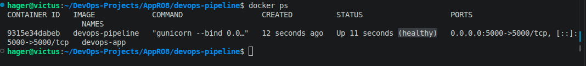

# DevOps Pipeline

A containerized Flask web application with Docker, Docker Compose, automated testing, a GitHub Actions CI/CD pipeline, GitHub Container Registry publishing, Prometheus monitoring, and a live staging deployment on Railway.

> **Repository:** https://github.com/Hager-83/devops-pipeline
> **Staging URL:** https://devops-pipeline-production.up.railway.app (verified live — see [Staging Deployment](#staging-deployment)).

## Architecture

```text
                    DevOps Pipeline
                         │
             ┌───────────┴───────────┐
             │                       │
        Flask App                Prometheus
       Container                 Container
        Port 5000                 Port 9090
             │                       │
             │ /metrics              │ scrape every 15s
             └───────────────────────┘
                    Docker Network

  GitHub Actions:  pytest  →  docker build + health check  →  push to GHCR
                   └────────── gated alternative: SSH deploy ──→  staging VM
  Railway (staging): auto-deploys this repo's Dockerfile on push to main
```



## Project Structure

```text
devops-pipeline/
├── app/
│   ├── app.py                      # Flask app: /, /health, /metrics
│   └── requirements.txt            # Flask, Gunicorn, Prometheus exporter, pytest
├── tests/
│   └── test_app.py                 # 4 pytest tests
├── monitoring/
│   └── prometheus.yml              # Prometheus scrape configuration
├── .github/
│   └── workflows/
│       └── ci-cd.yml               # CI: test → docker verify → publish → (gated) deploy
├── .dockerignore                   # Keeps build context clean
├── .env.example                    # Environment variable template
├── Dockerfile                      # python:3.12-slim + Gunicorn
├── docker-compose.yml              # Local stack: app + Prometheus
├── docker-compose.staging.yml      # Staging stack (prebuilt GHCR image)
├── pytest.ini
├── render.yaml                     # Render Blueprint (unused alternative; see Staging Deployment)
├── PROGRESS.md                     # Phase-by-phase development log
├── image.png
└── README.md
```

## Application Endpoints

| Endpoint   | Description                                  |
| ---------- | -------------------------------------------- |
| `/`        | Returns JSON: greeting + current `APP_ENV`   |
| `/health`  | Returns `{"status": "ok"}` — used by Docker, CI, and deploy checks |
| `/metrics` | Prometheus metrics (exposed by prometheus-flask-exporter) |

## Prerequisites

* Git, Docker, Docker Compose, Python 3.12+

```bash
git --version
docker --version
docker compose version
python3 --version
```

## Local Setup

```bash
git clone https://github.com/Hager-83/devops-pipeline.git
cd devops-pipeline
```

## Environment Configuration

| Variable   | Description               | Default | Example     |
| ---------- | ------------------------- | ------- | ----------- |
| `APP_ENV`  | Application environment   | `dev`   | `staging`   |
| `LOG_LEVEL`| Application logging level | `INFO`  | `DEBUG`     |

Copy the template and adjust if needed (`.env` is git-ignored and must never be committed):

```bash
cp .env.example .env
```

Docker Compose reads these variables and passes them into the container.

## Testing

```bash
python3 -m venv .venv
source .venv/bin/activate
pip install -r app/requirements.txt
pytest -v
```

Four tests cover: the home endpoint, the health endpoint, response body
content, and Prometheus metrics exposure. The same tests run in CI.

## Docker

Build and run manually:

```bash
docker build -t devops-pipeline:local .
docker run -d --name devops-app -p 5000:5000 devops-pipeline:local
curl http://localhost:5000/health     # {"status":"ok"}
curl http://localhost:5000/metrics    # Prometheus exposition format
docker stop devops-app && docker rm devops-app
```

Notes on the Dockerfile:

* Base image `python:3.12-slim` (small, official)
* Dependencies installed before copying code (better layer caching)
* `HEALTHCHECK` probes `/health` every 30s — Docker reports the container as `healthy`/`unhealthy`
* The app is served by **Gunicorn** (`--bind 0.0.0.0:5000 app:app`), not the Flask dev server
* `.dockerignore` keeps `.venv`, `.git`, tests, and docs out of the build context

## Docker Compose (local stack)

```bash
docker compose up -d --build
docker compose ps          # app should report (healthy)
```

* App: http://localhost:5000
* Prometheus: http://localhost:9090

Stop everything:

```bash
docker compose down
```

## Monitoring

Prometheus scrapes the app every 15 seconds via the Docker network
(`monitoring/prometheus.yml` targets `app:5000/metrics`).

Verify:

1. Open http://localhost:9090 → **Status → Targets**
2. Job `devops-app` should be **UP**
3. Query `flask_http_request_total` to see live request counts

## Logging

The application writes structured **JSON** logs, one object per line:

```json
{"time": "2026-10-18 05:58:34,563", "level": "INFO", "msg": "index requested"}
```

The log level is controlled by `LOG_LEVEL`. View logs with:

```bash
docker compose logs app
```

(Gunicorn's own startup messages use a plain-text format; application log lines are the JSON ones.)

## CI/CD Pipeline (GitHub Actions)

Workflow: `.github/workflows/ci-cd.yml`, triggered on every push/PR to `main`.

| Job               | What it does | When it runs |
| ----------------- | ------------ | ------------ |
| `test`            | Installs dependencies, runs `pytest -v` | Every push / PR |
| `docker`          | Builds the image, starts a container, curls `/health`, `/metrics`, and `/`, prints logs, removes the container (`if: always()` so cleanup happens even on failure) | After `test` passes |
| `publish`         | Logs into GHCR with the built-in `GITHUB_TOKEN` (permission `packages: write` only), builds and pushes `:latest` and `:sha-<commit>` tags | Pushes to `main` only |
| `deploy-staging`  | **Alternative (VPS) path:** SSHs to a server, pulls the image, starts the `docker-compose.staging.yml` stack, then curls `/health` | **Gated off** until `DEPLOY_STAGING` variable is set — the active staging path is Railway (below) |

A failure in any required job fails the workflow, which blocks the jobs that depend on it (`needs:` chain: test → docker → publish → deploy-staging).

## Using the GHCR image

After the `publish` job has run at least once:

```bash
docker pull ghcr.io/hager-83/devops-pipeline:latest
# or pin to a commit
docker pull ghcr.io/hager-83/devops-pipeline:sha-<commit-sha>
```

Public packages need no login; if the package is private, log in first:
`docker login ghcr.io -u <username> -p <token>`.

## Staging Deployment

**Status: LIVE — https://devops-pipeline-production.up.railway.app**
(Verified 2026-10-18: `/health` → `{"status":"ok"}`, `/` → `"env":"staging"`,
`/metrics` → Prometheus exposition format, all HTTP 200.)

### Hosting: Railway (free trial tier, $0, no credit card)

Render was the original plan but its signup demanded a credit card "for
identity verification" — abandoned rather than add a card. Railway was
selected instead because it deploys from GitHub **without any payment
method**.

Free-tier facts (verified October 2026):

| Aspect | Behavior |
| ------ | -------- |
| Cost | **$0** — sign up with GitHub, **no card required** |
| Trial | One-time **$5 usage credit, valid 30 days** — enough to run this app continuously through the demo window (~$2–3/month at this app's footprint) |
| After the trial | Drops to the Free plan ($1/month credit). When credit is exhausted the service **pauses** — with no card on file, Railway **cannot bill you**: worst case is downtime, never a charge |
| Deploys | Railway watches this repo and rebuilds the existing `Dockerfile` (port 5000, Gunicorn) on push to `main` |
| Endpoint | `https://devops-pipeline-production.up.railway.app` (HTTPS) |

How staging is configured: Railway builds the same `Dockerfile` the CI
tests and the local compose stack use; the service variable
`APP_ENV=staging` puts the app in staging mode (verified live in the `/`
response). The GitHub Actions pipeline (test → docker verify → GHCR
publish) runs independently and unchanged.

### Deployment instructions

**Redeploying an update (the normal flow):**

```bash
git push origin main
```

That's it — CI runs on GitHub, and Railway independently rebuilds and
redeploys the service from the same push (automatic deployment to staging).

**Recreating the staging deployment from scratch:**

1. Sign up at https://railway.com with GitHub (no payment method needed)
2. **New Project → Deploy from GitHub repo** → authorize Railway → select
   `Hager-83/devops-pipeline` (Railway builds the repo's `Dockerfile`, which
   listens on port 5000)
3. Service → **Variables** → add `APP_ENV=staging`
4. Service → **Settings → Networking → Generate Domain** to get the public
   HTTPS URL
5. Verify: `curl <url>/health` → `{"status":"ok"}` and `curl <url>/` →
   `"env":"staging"`

**Alternatives:** the SSH/VPS `deploy-staging` job (gated off, see below) or
the `render.yaml` Blueprint. Either can host the same image.

### Monitoring on staging — documented limitation

The Prometheus **container stack runs and is verified locally only**
(`docker compose up` → target `app` is UP at localhost:9090). A second
always-on Prometheus container does not fit a $0/no-card budget on any
current host (Railway's trial credit would be consumed by two services,
and free tiers that sleep would break scraping), so the staging URL
exposes the app's `/metrics` data directly instead of a Prometheus
dashboard. The CI workflow, health checks, and metrics endpoint all
remain identical between local and staging.

### Other deployment paths (documented, unused)

* **`render.yaml`** — Render Blueprint kept for reference (renders the same
  Dockerfile, free plan, `/health` check). Unused because Render's signup
  required a card in this case.
* **`deploy-staging` job** in `.github/workflows/ci-cd.yml` — a complete
  SSH-based CD job (needs: `publish`, deploys
  `docker-compose.staging.yml`, verifies `/health` afterwards). Stays
  **gated off** because no VPS exists. To enable it later: provision any
  server with Docker, then set the repository secrets/variables listed in
  that workflow's header comment (`STAGING_HOST`, `STAGING_USER`,
  `STAGING_SSH_KEY`, `STAGING_URL`, `DEPLOY_STAGING=true`).

## Troubleshooting

```bash
docker compose logs app          # application logs
docker compose logs prometheus   # Prometheus logs
docker compose ps                # container states (healthy/unhealthy)
curl http://localhost:5000/health
curl http://localhost:5000/metrics
```

## Submission Links

* **GitHub repository:** https://github.com/Hager-83/devops-pipeline
* **Staging URL:** https://devops-pipeline-production.up.railway.app
  (verified 2026-10-18: `/health` 200, `/` reports `env=staging`, `/metrics`
  serves Prometheus metrics)
